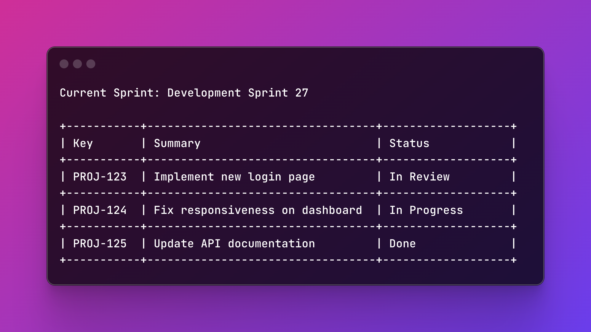

<div align="center">

# jit

Jira CLI for ticket lookup, JQL search, sprint views, and creating, editing, or managing issues from the terminal.

[](https://crates.io/crates/jit-cli)
[](LICENSE)

[Install](#install) · [Quickstart](#quickstart) · [Agent Setup](#agent-setup) · [Examples](#examples) · [Commands](#commands)



</div>

---

## Quick Examples

```bash
# summary
jit ISSUE-123
```

```text
Ticket:   ISSUE-123
Summary:  Fix the login button in Safari
```

```bash
# one-line output
jit --text ISSUE-123
```

```text
ISSUE-123: Fix the login button in Safari
```

```bash
# json
jit --json ISSUE-123
```

```json
{"ticket":"ISSUE-123","summary":"Fix the login button in Safari"}
```

```bash
# full table
jit --show --full ISSUE-123
```

```text
TICKET DETAILS

ISSUE-123: Fix the login button in Safari

Type:       Bug                  Priority:   Medium
Status:     In Progress          Sprint:     Development Sprint 27
Assignee:   John Doe             Reporter:   Jane Smith
Created:    2023-09-15           Updated:    2023-09-16
Due Date:   2023-09-30
```

```bash
# current sprint
jit --my-tickets --limit 3
```

```text
Current Sprint: Development Sprint 27

+-----------+----------------------------------+-------------------+
| Key       | Summary                          | Status            |
+-----------+----------------------------------+-------------------+
| PROJ-123  | Implement new login page         | In Review         |
+-----------+----------------------------------+-------------------+
| PROJ-124  | Fix responsiveness on dashboard  | In Progress       |
+-----------+----------------------------------+-------------------+
| PROJ-125  | Update API documentation         | Done              |
+-----------+----------------------------------+-------------------+
```

## Install

```bash
cargo install jit-cli
```

Build from source:

```bash
git clone https://github.com/cesarferreira/jit
cd jit
cargo build --release
./target/release/jit --version
```

## Quickstart

Create `~/.config/jit/config.toml`:

```bash
mkdir -p ~/.config/jit
cat > ~/.config/jit/config.toml <<'EOF'
[jira]
base_url = "https://your-company.atlassian.net"
api_token = "your_api_token_here"
user_email = "your_email@example.com"
EOF
```

Then run a few common commands:

```bash
# Ticket summary
jit ISSUE-123

# Compact one-line output
jit --text ISSUE-123

# Full ticket details with comments and PRs
jit --show --full ISSUE-123

# Current sprint tickets assigned to you
jit --my-tickets

# Create a ticket assigned to you in the current sprint
jit create --project RW --summary "Improve ticket creation flow"

# Edit an existing issue
jit edit RW-123 --summary "Refine edit flow"
```

## Agent Setup

The repo ships a shared agent skill in [`SKILL.md`](SKILL.md). Install or update it for every detected supported coding agent in one command:

```bash
jit skill install
```

This detects existing agent config directories and installs the `SKILL.md` bundled with your installed `jit` binary into each matching agent. It creates missing skill subdirectories and replaces existing jit skills, without creating config folders for absent agents:

- `~/.codex/skills/jit/SKILL.md` (Codex)
- `~/.claude/skills/jit/SKILL.md` (Claude Code)
- `~/.pi/agent/skills/jit/SKILL.md` (Pi)
- `~/.cursor/skills/jit/SKILL.md` (Cursor)
- `~/.gemini/config/skills/jit/SKILL.md` (Antigravity App/IDE)

Detection checks `~/.codex`, `~/.claude`, `~/.pi/agent`, `~/.cursor`, and `~/.gemini/config`. Antigravity also supports an existing `~/.gemini/antigravity` directory; it uses the current config directory when both exist. No installed executables are probed. If no supported config directories exist, the command reports that nothing was found and leaves the filesystem unchanged.

Installation needs no network connection or Jira credentials. To install skills from a local checkout, run `cargo run -- skill install`; to update the installed CLI and its skills together, run `cargo install --path .` followed by `jit skill install`.

Select only the agents you want with `--agent` (comma-separated or repeated). Names are case insensitive; duplicate selections are installed once. Without `--agent`, it installs for all detected targets. Explicit selections can create the selected agents' config folders even if absent:

```bash
jit skill install --agent codex
jit skill install --agent claude
jit skill install --agent pi,cursor,antigravity
jit skill install --agent codex --agent claude
```

The additional targets use the global skill locations documented by [Pi](https://github.com/earendil-works/pi/blob/main/packages/coding-agent/docs/skills.md), [Cursor](https://cursor.com/help/customization/skills), and [Antigravity](https://antigravity.google/docs/skills#antigravity-ide-skill-locations). The Antigravity target covers its App/IDE, whose global directory differs from the Antigravity CLI.

## Examples

### Ticket lookup

Default summary output:

```bash
jit ISSUE-123
jit https://your-company.atlassian.net/browse/ISSUE-123
```

Example output:

```text
Ticket:   ISSUE-123
Summary:  Fix the login button in Safari
```

Compact output for scripts or quick scanning:

```bash
jit --text ISSUE-123
```

Example output:

```text
ISSUE-123: Fix the login button in Safari
```

JSON output:

```bash
jit --json ISSUE-123
jit --json https://your-company.atlassian.net/browse/ISSUE-123
```

Example output:

```json
{"ticket":"ISSUE-123","summary":"Fix the login button in Safari"}
```

### Detailed issue views

Show a formatted table:

```bash
jit --show ISSUE-123
jit --show https://your-company.atlassian.net/browse/ISSUE-123
```

Include richer context as needed:

```bash
jit --show --include-description ISSUE-123
jit --show --include-comments ISSUE-123
jit --show --include-prs ISSUE-123
jit --show --full ISSUE-123
jit --json --full ISSUE-123
```

`--full` is the shortest path when you want description, comments, pull requests, and metadata together.

Example output:

```text
TICKET DETAILS

ISSUE-123: Fix the login button in Safari

Type:       Bug                  Priority:   Medium
Status:     In Progress          Sprint:     Development Sprint 27
Assignee:   John Doe             Reporter:   Jane Smith
Created:    2023-09-15           Updated:    2023-09-16
Due Date:   2023-09-30

DESCRIPTION

The login button doesn't work properly in Safari browsers.
Steps to reproduce:
1. Open the login page in Safari
2. Click on the login button
3. Nothing happens
```

### Comments, history, and linked PRs

Limit comments:

```bash
jit --show --include-comments --comments-limit 3 ISSUE-123
jit --json --include-comments --comments-limit 3 ISSUE-123
```

Return all comments:

```bash
jit --show --include-comments --all-comments ISSUE-123
jit --json --include-comments --all-comments ISSUE-123
```

Filter comments by date:

```bash
jit --show --include-comments --since 2026-01-01 ISSUE-123
jit --json --include-comments --since 2026-01-01 ISSUE-123
```

Include linked pull requests:

```bash
jit --show --include-prs ISSUE-123
jit --json --include-prs ISSUE-123
```

When an issue response contains only part of its comment history, `jit` fetches the remaining pages before applying comment date filters and limits.

### Current sprint tickets

No arguments defaults to your current sprint tickets:

```bash
jit
```

Explicit forms:

```bash
jit --my-tickets
jit --my-tickets --include-prs
jit --my-tickets --limit 5
```

The current sprint view fetches up to 50 tickets by default. Use `--limit` to narrow or expand the result set. `jit --my-tickets --json` returns the same paginated `{ "issues": [], "truncated": false }` envelope as `search`; `truncated: true` means more matching issues exist beyond the limit.

Example output:

```text
Current Sprint: Development Sprint 27

+-----------+----------------------------------+-------------------+
| Key       | Summary                          | Status            |
+-----------+----------------------------------+-------------------+
| PROJ-123  | Implement new login page         | In Review         |
+-----------+----------------------------------+-------------------+
| PROJ-124  | Fix responsiveness on dashboard  | In Progress       |
+-----------+----------------------------------+-------------------+
| PROJ-125  | Update API documentation         | Done              |
+-----------+----------------------------------+-------------------+
```

### Search issues with JQL

```bash
jit search --jql 'project = RW AND statusCategory != Done ORDER BY updated DESC'
jit search --jql 'assignee = currentUser()' --limit 100 --json
```

Search follows Jira pagination up to `--limit` (50 by default). JSON returns an object with `issues` and `truncated`; check `truncated` before treating the result as complete.

### Discover boards and sprints

```bash
jit boards --project RW --json
jit sprints --board 123 --state active --json
jit sprints --board 123 --state active,future --json
```

Omit `--project` to list accessible boards. Sprint state accepts `active`, `future`, `closed`, or a comma-separated combination. Use the returned board ID with creation or `edit --current-sprint --board ID`.

### Transition, comment, and link issues

List available transitions before changing status. `--to` accepts a transition name or ID:

```bash
jit transitions RW-123 --json
jit transition RW-123 --to 'In Progress' --json
```

The CLI does not supply transition-specific required fields such as resolution; Jira validation errors are surfaced if a transition requires them.

Add a comment inline, from a UTF-8 file, or from standard input. Choose exactly one body source:

```bash
jit comment RW-123 --body 'Verified the fix locally.' --json
jit comment RW-123 --body-file /path/to/comment.txt
printf '%s' 'Verified the fix locally.' | jit comment RW-123 --body-file -
```

Create a dependency or use another Jira issue-link type by name or ID:

```bash
jit link RW-123 --blocks RW-456 --json
jit link RW-123 --to RW-456 --type 'Relates' --json
```

`--blocks` means the source issue blocks the target issue. The generic form makes the source display the link type's outward relationship to the target.

### Create tickets

New tickets default to the authenticated Jira user (`--assignee me`) and the current active sprint:

```bash
jit create --project RW --summary "Improve ticket creation flow"
```

Create with explicit type and description:

```bash
jit create \
  --project RW \
  --type Story \
  --summary "Support ticket creation" \
  --description $'Add a create command\nCover it with tests'
```

Override the assignee or leave the ticket unassigned:

```bash
jit create --project RW --assignee 5b10a2844c20165700ede21g --summary "Fix validation"
jit create --project RW --assignee unassigned --summary "Triage item without an owner"
```

Return the created issue as JSON:

```bash
jit create --project RW --summary "Improve ticket creation flow" --json
```

Example output:

```text
Created:  RW-123
Project:  RW
Type:     Task
Assignee: Cesar Ferreira
Summary:  Improve ticket creation flow
Board:    RW board
Sprint:   RW Sprint 42
Backlog:  No (added to current sprint)
URL:      https://your-company.atlassian.net/browse/RW-123
```

### Create backlog tickets

Pass `--backlog` explicitly to create without sprint assignment. The assignee still defaults to you:

```bash
jit create --project RW --backlog --summary "Save for later"
```

`--backlog` conflicts with `--current-sprint` and `--board`.

### Select the current sprint

Without `--backlog`, `jit` resolves the active sprint through Jira Software before creating the issue, then adds it to that sprint. It checks accessible Scrum boards for the project and uses the active sprint with the most recent `startDate`. Pass `--board` to select a specific board:

```bash
jit create --project RW --board 123 --summary "Use the board's active sprint"
```

`--current-sprint` remains supported as an explicit spelling of the default. If no active sprint is found, no issue is created; select another board, start a sprint in Jira, or pass `--backlog`. If creation succeeds but sprint assignment fails, the command reports the created ticket key so you can retry with `jit edit ISSUE-123 --current-sprint` instead of creating a duplicate.

### Edit existing tickets

Update the summary:

```bash
jit edit RW-123 --summary "Improve edit flow"
```

Update the description:

```bash
jit edit RW-123 --description $'First line\nSecond line'
```

Clear the description:

```bash
jit edit RW-123 --description ''
```

Change issue type and assignee:

```bash
jit edit RW-123 --type Bug --assignee 5b10a2844c20165700ede21g
```

Keep a task as `Task` while updating other fields:

```bash
jit edit RW-123 --type Task --summary "Refine task summary"
```

Unassign the issue:

```bash
jit edit RW-123 --assignee unassigned
```

Use the current Jira user as assignee:

```bash
jit edit RW-123 --assignee me
```

Move an existing ticket into the current sprint (ticket URLs also work):

```bash
jit edit RW-123 --current-sprint
jit edit https://your-company.atlassian.net/browse/RW-123 --current-sprint --board 123
jit edit RW-123 --summary "Ready for this sprint" --current-sprint --json
```

Sprint selection matches `create --current-sprint`: without `--board`, use the most recently started active sprint on accessible Scrum boards for the ticket's project. `--board` requires `--current-sprint`. No duplicate issue is created, and sprint-only edits do not change core fields or the assignee.

Sprint resolution happens before any changes. For combined edits, core fields are saved first, then the issue is moved. If moving fails, the command exits unsuccessfully and reports that core fields were updated; those changes are not rolled back. A core-field failure prevents the sprint move. Failed commands report errors on stderr and emit no success JSON; `--json` formats the error as JSON with any completed operations.

Successful sprint edits include `sprint`, `sprint_id`, `board`, and `board_id` in JSON, with `"sprint"` in `updated_fields`. These describe the sprint assignment accepted by Jira.

Return update results as JSON:

```bash
jit edit RW-123 --summary "Improve edit flow" --json
```

Example output:

```text
Updated:  RW-123
Fields:   summary
Summary:  Improve edit flow
URL:      https://your-company.atlassian.net/browse/RW-123
```

`jit edit` updates only the fields you pass. It works for Task issues as well as other Jira issue types. `--description ''` clears the description, and `--assignee unassigned` clears the assignee.

### Read descriptions from files or standard input

Both `create` and `edit` accept `--description-file PATH`; use `-` for standard input. It conflicts with `--description`:

```bash
jit create --project RW --summary 'Improve validation' --description-file /path/to/description.txt
jit edit RW-123 --description-file /path/to/description.txt
printf '%s' 'Updated details' | jit edit RW-123 --description-file -
```

### JSON success and error handling

Noninteractive query, issue, and discovery commands support `--json`, including top-level `jit --json COMMAND ...`. Their successes write JSON only to stdout. Interactive `auth` and skill installation retain their own output formats. Failures exit nonzero and write a JSON error object to stderr with `error.code`, `error.message`, `error.ticket`, and `error.completed_operations`. The ticket is available when known; completed operations are an array.

For create/edit partial failures, inspect the ticket and completed operations before retrying. `created` means the issue already exists: retry its sprint assignment with `jit edit KEY --current-sprint`, adding the original `--board` when applicable. `core_fields_updated` means the edit was saved before the sprint move failed: retry only the move. These operations are not rolled back, and failures emit no success JSON.

### Use a specific config file

```bash
jit --config-file /path/to/config.toml ISSUE-123
jit --config-file /path/to/config.toml --my-tickets
jit --config-file /path/to/config.toml create --project RW --summary "Improve ticket creation flow"
jit --config-file /path/to/config.toml edit RW-123 --summary "Improve edit flow"
```

## Commands

| Command | What it does |
|---|---|
| `jit ISSUE-123` | Show ticket summary |
| `jit --text ISSUE-123` | Show one-line `KEY: Summary` output |
| `jit --json ISSUE-123` | Return machine-readable JSON |
| `jit --show ISSUE-123` | Show detailed ticket fields in a table |
| `jit --show --full ISSUE-123` | Include description, comments, pull requests, and metadata |
| `jit --my-tickets` | List current sprint tickets assigned to you |
| `jit search --jql '...'` | Search issues with pagination and a result limit |
| `jit boards [--project KEY]` | List accessible boards |
| `jit sprints --board ID [--state active,future]` | List board sprints |
| `jit transitions KEY` | List available status transitions |
| `jit transition KEY --to NAME_OR_ID` | Apply an available transition |
| `jit comment KEY --body TEXT` | Add a comment; `--body-file PATH` also accepts `-` for stdin |
| `jit link SOURCE --blocks TARGET` | Mark the source as blocking the target |
| `jit link SOURCE --to TARGET --type NAME_OR_ID` | Create a Jira issue link |
| `jit create ...` | Create an issue assigned to you in the current sprint |
| `jit create --backlog ...` | Create an issue without sprint assignment |
| `jit create --current-sprint ...` | Create an issue and add it to the active sprint |
| `jit edit ...` | Update summary, description, type, assignee, or current sprint |
| `jit skill install` | Install for all supported agents with existing config folders; `--agent` overrides detection |
| `jit --config-file /path/to/config.toml ...` | Use a specific config file |

## Configuration

Run the interactive auth wizard:

```bash
jit auth
```

The wizard asks for your Jira company URL and email, opens the Atlassian API token page, validates the token you paste, and writes credentials to `~/.config/jit/config.toml`.

To write a specific config file instead:

```bash
jit --config-file /path/to/config.toml auth
```

`jit` looks for Jira credentials in this order:

1. `--config-file <path>`
2. `config.toml` in the current directory
3. `~/.config/jit/config.toml`

Example config:

```toml
[jira]
base_url = "https://your-company.atlassian.net"
api_token = "your_api_token_here"
user_email = "your_email@example.com"
```

Optional `[jira]` settings select custom fields for reading sprint and acceptance criteria across Jira installations:

```toml
sprint_field = "customfield_10020"
acceptance_criteria_field = "customfield_10396"
```

These are the backward-compatible defaults. Set the field IDs used by your Jira instance. Refreshing credentials with `jit auth` preserves these field overrides.

## Development

Run locally:

```bash
cargo run -- ISSUE-123
cargo run -- --my-tickets
cargo run -- create --project RW --summary "Improve ticket creation flow"
```

Build a release binary:

```bash
cargo build --release
```

Get an Atlassian API token:

1. Go to `https://id.atlassian.com/manage-profile/security/api-tokens`
2. Click `Create API token`
3. Name it
4. Copy it into `~/.config/jit/config.toml` under the `[jira]` section

## License

MIT © Cesar Ferreira
